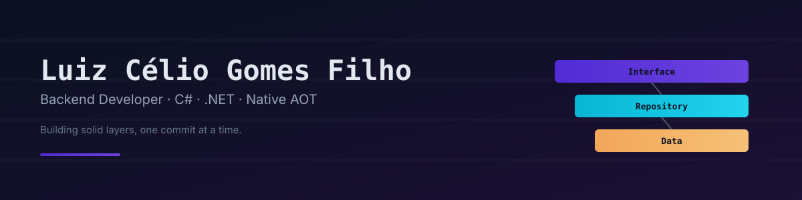

  

&nbsp;

---

## 🇧🇷 Português

### 👋 Sobre mim

Sempre gostei de programar, e mesmo antes de entrar no curso de Análise e Desenvolvimento de Sistemas, na FATEC Guaratinguetá, já aprendia (fuçando) algumas coisas por conta própria. Na faculdade, tive contato com várias áreas do desenvolvimento e foi difícil escolher uma entre tantas coisas interessantes — mas tive certeza do caminho que queria seguir quando começamos a desenvolver o TCC.

Concilio a transição de carreira com a rotina de pai de duas filhas — o que só reforça minha disciplina, gestão de tempo e comprometimento com o que me proponho a aprender.

Hoje busco uma oportunidade concreta para aplicar o que já aprendi e, principalmente, **aprender ainda mais junto de um time de desenvolvedores mais experientes** — trabalhar perto de gente que já passou pelos desafios que eu ainda vou enfrentar é o tipo de ambiente onde cresço mais rápido.

### 📚 Em constante estudo

Estou sempre com algum curso ou projeto pessoal em andamento para aprofundar a stack abaixo — recentemente explorei **Native AOT compilation** e **Minimal APIs** no .NET, e sigo evoluindo em Angular e Flutter.

### 🚀 Habilidades Técnicas

**Linguagens:** C#

**Backend:** ASP.NET, Minimal API (EF Core / Native AOT), API REST

**Banco de dados:** SQL Server, PostgreSQL

**Frontend:** Angular, Angular Material, Bootstrap, SCSS, Flutter

**Ferramentas:** Git, GitHub, Visual Studio, VS Code

### 🏆 Projetos em destaque

- **[AOT-Native](https://github.com/Domzera/AOT-Native)** — API de CRUD de usuários explorando **Native AOT compilation** e **Minimal APIs** no .NET, com autenticação JWT e PostgreSQL. Projeto 100% autoral, feito para entender na prática por que Native AOT exige abrir mão de Controllers/MVC em favor de Minimal APIs.
- **[LocalWise](https://github.com/Domzera/LocalWise)** — Trabalho de Conclusão de Curso. Reuni tudo que aprendi na faculdade e em pesquisas extras para colocá-lo em prática. Ficou grande demais para terminar no prazo, mas é o projeto que mais me orgulha, pelo tanto que exigiu de mim.
- **[Site Catalogo - Polimedica do vale]([https://github.com/Domzera/Polimedica_Site](https://github.com/Domzera/Site_Polimedica))** — Desenvolvi o site catalogo com a possibilidade de se tornar site de vendas no futuro. Este site tem controle de usuários e categoria de produtos com fotos.

### 📫 Contato

[LinkedIn](https://www.linkedin.com/in/luiz-cgomes/?isSelfProfile=true) · [GitHub](https://github.com/Domzera)

---

## 🇺🇸 English

### 👋 About me

I've always liked programming, and even before starting my degree in Systems Analysis and Development at FATEC Guaratinguetá, I was already teaching myself a few things out of curiosity. During college, I got exposed to several areas of development, and picking just one wasn't easy — but I found real clarity about the path I wanted when we started working on our capstone project.

I'm balancing this career transition with being a father of two — which has only sharpened my discipline, time management, and commitment to what I set out to learn.

I'm currently looking for a real opportunity to put what I've learned into practice and, just as importantly, **to keep learning alongside a team of more experienced developers** — being close to people who've already faced the challenges ahead of me is where I grow fastest.

### 📚 Always learning

I keep a course or personal project running to go deeper into the stack below — most recently exploring **Native AOT compilation** and **Minimal APIs** in .NET, while continuing to build with Angular and Flutter.

### 🚀 Tech Stack

**Languages:** C#

**Backend:** ASP.NET, Minimal API (EF Core / Native AOT), REST API

**Databases:** SQL Server, PostgreSQL

**Frontend:** Angular, Angular Material, Bootstrap, SCSS, Flutter

**Tools:** Git, GitHub, Visual Studio, VS Code

### 🏆 Featured Projects

- **[AOT-Native](https://github.com/Domzera/AOT-Native)** — A user CRUD API exploring **Native AOT compilation** and **Minimal APIs** in .NET, with JWT authentication and PostgreSQL. A fully self-driven project built to understand, hands-on, why Native AOT means trading Controllers/MVC for Minimal APIs.
- **[LocalWise](https://github.com/Domzera/LocalWise)** — My capstone project. I brought together everything I learned in college and through extra research to make it work. It grew too large to fully finish in time, but it's the project I'm proudest of, for everything it demanded from me.
- **[Product Catalog Website]([https://github.com/Domzera/Polimedica_Site](https://github.com/Domzera/Site_Polimedica))** - Polimedica do Vale — I developed this catalog website with the potential to expand into an e-commerce platform in the future. It features user authentication and product categorization with images.

### 📫 Contact

[LinkedIn](https://www.linkedin.com/in/luiz-cgomes/?isSelfProfile=true) · [GitHub](https://github.com/Domzera)
